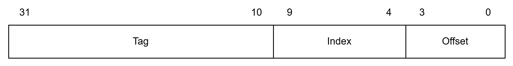
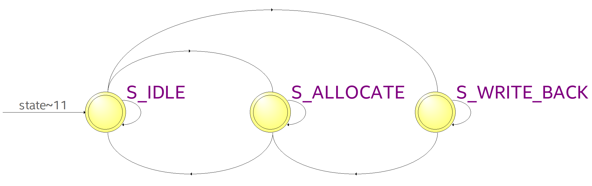
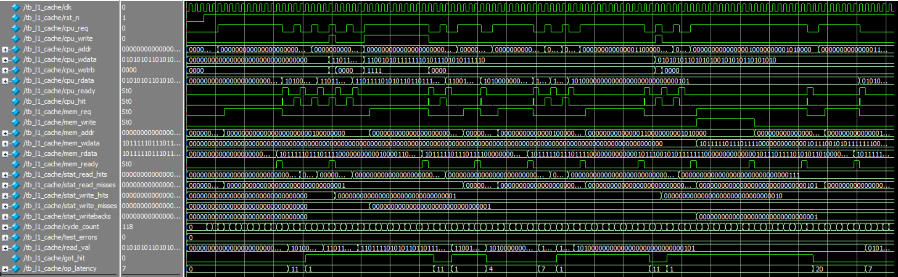

# Parameterized 2-Way Set-Associative L1 Cache Controller in Verilog

A high-performance, synthesizable, parameterized L1 Cache Controller implemented in Verilog. Designed for 32-bit RISC processors (such as RISC-V RV32I) and accelerators to overcome the memory-wall latency bottleneck between fast processor pipelines and slower main memory.

## Key Features

- 2-Way Set-Associative Architecture: Balances fast single-cycle lookups with reduced conflict misses.
- Single-Cycle Hit Latency: Parallel tag matching and word selection deliver 1-cycle throughput on read and write hits.
- Write-Back with Write-Allocate: Keeps data changes in cache and only writes back to main memory when a modified line is evicted, saving bus bandwidth.
- True 1-bit LRU Eviction: Tracks which line was accessed least recently in each set, giving priority to empty lines first.
- On-Chip Performance Counters: Hardware telemetry registers track read hits, read misses, write hits, write misses, and writebacks to evaluate cache efficiency.
- Testbench and Memory Model: Includes a full behavioral memory model and comprehensive test suite.

## Cache Configuration and Capacity

Default hardware dimensions:

- Address Width: 32 bits
- Word Data Width: 32 bits (4 bytes)
- Cache Line Size: 16 bytes (128 bits, holds 4 words)
- Number of Sets: 64 sets
- Associativity: 2 ways per set
- Total Capacity: 64 sets x 2 ways x 16 bytes = 2048 bytes (2 KB)

## Internal Storage Structure

Each of the 64 sets contains two independent ways (Way 0 and Way 1) using the following storage arrays:

- Tag Array: Stores 22-bit address tags to identify which memory block is currently held.
- Valid Bit: 1 bit per line indicating if the line holds valid data.
- Dirty Bit: 1 bit per line indicating if data was modified and needs to be written back to memory upon eviction.
- Data Array: Stores the 128-bit cache line contents (four 32-bit words).
- LRU Bit: 1 bit per set tracking access recency (points to Way 0 or Way 1 as the next victim).

## Architecture Specification

### 32-Bit Address Partitioning

The 32-bit CPU address is split into three parts:

- Tag (Bits 31:10, 22 bits): Compared against stored tags in both ways to determine a hit.
- Index (Bits 9:4, 6 bits): Selects one of the 64 sets in the cache (2 to the power of 6 = 64).
- Offset (Bits 3:0, 4 bits): Selects the byte within the 16-byte line. Bits 3:2 choose the 32-bit word, and bits 1:0 choose the byte lane.

### Replacement Policy

When a miss occurs and a line must be brought into the cache, the controller chooses a replacement way in this order:

- If Way 0 is empty (invalid), choose Way 0.
- If Way 1 is empty (invalid), choose Way 1.
- If both ways are full, use the 1-bit LRU flag to replace the least recently used way.

### Core Controller FSM

The controller operates using a 3-state finite state machine:

- S_IDLE: Serves CPU requests. Read and write hits complete in 1 cycle. On a miss, it stalls the CPU and moves to S_WRITE_BACK if the victim line is dirty, or S_ALLOCATE if clean.
- S_WRITE_BACK: Writes a dirty victim line back to memory, then transitions to S_ALLOCATE.
- S_ALLOCATE: Fetches the missing line from memory, updates the cache, completes the CPU request, and returns to S_IDLE.

### Performance and Timing (AMAT)

Average Memory Access Time (AMAT) measures average access speed:
AMAT = Hit Time + (Miss Rate x Miss Penalty)

Under default simulation settings with 8-cycle memory latency:

- Cache Hit: 1 clock cycle.
- Clean Miss Penalty: 9 clock cycles (8 memory cycles + 1 allocate cycle).
- Dirty Miss Penalty: 17 clock cycles (8 writeback cycles + 8 allocate cycles + 1 cycle).

For a 90 percent hit rate with 20 percent dirty evictions:

- Effective Miss Penalty: (0.80 x 9) + (0.20 x 17) = 10.6 cycles.
- AMAT: 1 + (0.10 x 10.6) = 2.06 cycles per access.
  Compared to flat 8-cycle uncached access, this represents an approximate 3.88x speedup.

### Waveform

The waveform demonstrates key cache behaviors:

- Cold Read Miss: Stalls the CPU while fetching the missing line from memory, completing in 11 cycles.
- Read Hit: Returns requested data in 1 cycle with cpu_hit asserted.
- Write Hit: Updates cache data in 1 cycle and marks the line dirty.
- Write Miss: Fetches the missing line from memory, merges CPU write data, and marks the line dirty.
- 2-Way Associativity: Retains two lines in the same set simultaneously without conflict.
- Dirty Eviction: Writes modified data back to memory before allocating the new line, taking 20 cycles total.
