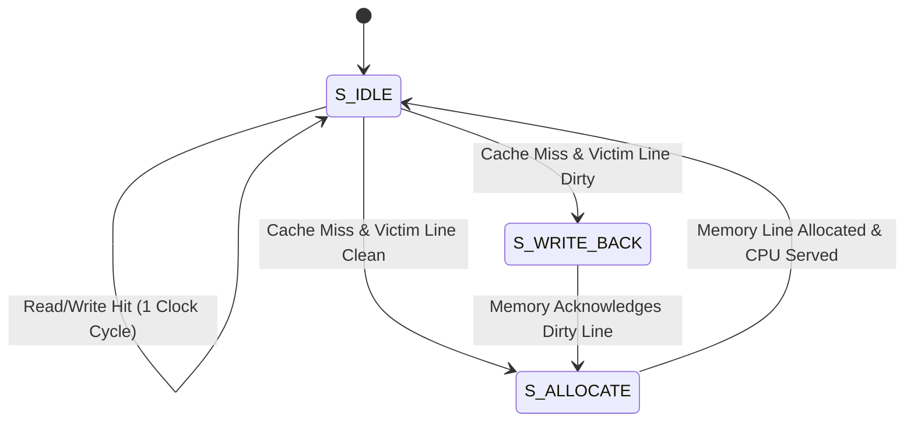

# Parameterized 2-Way Set-Associative L1 Cache Controller in Verilog

[-blue.svg)](#)
[](#)
[](#)
[-success.svg)](#)

A high-performance, synthesizable, parameterized **L1 Cache Controller** implemented in Verilog. Designed for integration with 32-bit RISC processors (e.g., RISC-V RV32I) and domain-specific accelerators, addressing the memory-wall latency bottleneck.

---

## Key Features

- **2-Way Set-Associative Architecture**: Parameterized set count (`NUM_SETS = 64`), line size (`16 Bytes / 128 bits`), and address width (`32 bits`), providing 2 KB default L1 capacity.
- **Single-Cycle Hit Latency**: Parallel combinational tag matching and word multiplexing delivering 1-cycle throughput on both read and write hits.
- **Write-Back with Write-Allocate**: Employs per-line dirty bits and byte-enable strobes (`wstrb`) to minimize off-chip DRAM bus transactions.
- **True 1-bit LRU Eviction**: Tracks way recency per set with automatic preferential allocation to invalid lines.
- **On-Chip Performance Counters**: Hardware telemetry registers for `stat_read_hits`, `stat_read_misses`, `stat_write_hits`, `stat_write_misses`, and `stat_writebacks` to evaluate AMAT in real-time.
- **Complete Testbench & Memory Model**: Includes behavioral DRAM/L2 memory model with configurable burst access latency.

---

## Architecture Specification

### 32-Bit Address Partitioning

```
+------------------------------------+----------------+-------------------+
|         TAG (Bits 31..10)          | INDEX (9..4)   | OFFSET (3..0)     |
|              22 bits               |    6 bits      | 4 bits (16 Bytes) |
+------------------------------------+----------------+-------------------+
                                                      | W_OFF  | B_OFF    |
                                                      | (3..2) | (1..0)   |
                                                      +--------+----------+
```

### Core Controller FSM



---

## Repository Structure

```
l1-cache-controller/
├── doc/
│   └── l1_cache_architecture.md    # Detailed architectural specification & AMAT equations
├── sim/
│   ├── main_memory_model.v         # Behavioral DRAM/L2 burst memory model
│   ├── tb_l1_cache.v               # 8-scenario comprehensive verification testbench
│   └── run_sim.py                  # Cross-platform 1-click simulation script
├── src/
│   ├── cache_def.vh                # Global parameters & state definitions
│   └── l1_cache_controller.v       # Synthesizable 2-Way L1 Cache Controller
├── .gitignore                      # ModelSim & Quartus ignore definitions
└── README.md                       # Project documentation & benchmark scorecard
```

---

## Verification & Benchmark Scorecard

The testbench systematically validates 8 core architectural behaviors:
1. **Cold Read Miss**: Stalls CPU pipeline and allocates line from lower memory.
2. **Single-Cycle Read Hit & Spatial Locality**: Verifies consecutive word access in 1 cycle.
3. **Single-Cycle Write Hit**: Updates cache line, marks dirty bit, completes in 1 cycle.
4. **Write Miss with Write-Allocate**: Fetches line, merges CPU write strobes, installs dirty line.
5. **2-Way Associativity**: Confirms distinct memory tags mapping to the same set coexist without conflict eviction.
6. **Clean LRU Eviction**: Evicts clean line without issuing redundant memory write requests.
7. **Dirty LRU Eviction**: Automatically issues 128-bit memory writeback before line allocation.
8. **Memory Consistency**: Validates that written-back data persists in lower memory.

### Simulation Output

```text
=================================================================
       L1 CACHE HARDWARE PERFORMANCE SCORECARD (FOR CV/PAPER)
=================================================================
  Total CPU Requests      : 16
  Read Hits               : 7
  Read Misses             : 6
  Write Hits              : 2
  Write Misses            : 1
  Total Cache Hits        : 9
  Total Cache Misses      : 7
  Dirty Line Writebacks   : 1
-----------------------------------------------------------------
  Hit Latency             : 1 Clock Cycle (Sustained)
  Miss Penalty (Clean)    : 9 Clock Cycles
  Miss Penalty (Dirty)    : 17 Clock Cycles
=================================================================
>>> ALL TESTS PASSED SUCCESSFULLY! (0 ERRORS) <<<
=================================================================
```

---

## How to Run Simulation

### Method 1: Using Python Script (Automated)
```bash
python sim/run_sim.py
```

### Method 2: Using ModelSim CLI directly
```bash
vlib work
vlog -work work +incdir+src src/l1_cache_controller.v sim/main_memory_model.v sim/tb_l1_cache.v
vsim -c -do "run -all; quit -f" work.tb_l1_cache
```

---

## Academic & CV Highlights

- **Computer Architecture Fundamentals**: Demonstrates clear mastery of cache hierarchies, set-associative tag arrays, LRU replacement policies, and dirty-bit writeback mechanics.
- **Synthesizable Verilog**: Written to strictly adhere to synthesizable RTL standards, compatible with Intel Quartus Prime (Cyclone/MAX/Stratix) and AMD/Xilinx Vivado.
- **Hardware Telemetry for AMAT**: Enables empirical profiling of cache miss penalties and memory stalls in processor sub-systems.
