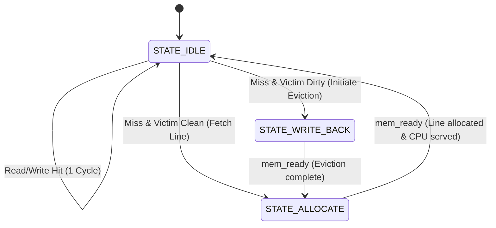

# Parameterized 2-Way Set-Associative L1 Cache Controller Specification

## 1. Architectural Overview & Academic Significance

In modern high-performance microprocessors and domain-specific AI accelerators, computation throughput is overwhelmingly constrained by the **memory wall**—the orders-of-magnitude latency discrepancy between on-chip logic pipelines and off-chip DRAM. 

This repository implements a **fully synthesizable, cycle-accurate Parameterized 2-Way Set-Associative L1 Cache Controller** written in IEEE 1364-2001 Verilog. The design demonstrates core computer architecture principles:
- **Set Associativity:** Reduces conflict misses compared to direct-mapped caches while preserving low lookup latency.
- **Write-Back with Write-Allocate:** Minimizes off-chip memory bandwidth consumption by deferring updates until line eviction.
- **True 1-bit LRU (Least Recently Used) Replacement:** Maximizes temporal locality preservation.
- **Hardware Telemetry:** Integrated on-chip performance counters tracking hit rates and memory writebacks for Average Memory Access Time (AMAT) evaluation.

---

## 2. Parameterization & Address Partitioning

The controller exposes top-level Verilog parameters to configure cache dimensions seamlessly:

| Parameter | Default Value | Description |
| :--- | :---: | :--- |
| `ADDR_WIDTH` | 32 | CPU & System Memory Address bus width |
| `DATA_WIDTH` | 32 | Word size serviced to CPU core (32-bit) |
| `LINE_BYTES` | 16 | Cache line size (16 bytes = 128 bits = 4 words) |
| `NUM_SETS` | 64 | Number of associative sets |
| `NUM_WAYS` | 2 | Degrees of associativity (2-Way) |

### Total Cache Capacity
$$\text{Capacity} = \text{NUM\_SETS} \times \text{NUM\_WAYS} \times \text{LINE\_BYTES} = 64 \times 2 \times 16 = 2{,}048 \text{ Bytes (2 KB)}$$

### 32-Bit Address Bit Decomposition

```
 31                          10 9            4 3   2 1 0
+------------------------------+--------------+-----+---+
|          TAG (22 bits)       |  INDEX (6 b) | W_O |B_O|
+------------------------------+--------------+-----+---+
                                               \_______/
                                                OFFSET (4 bits)
```

- **Byte Offset (`OFFSET_BITS = 4`)**: Bits `[3:0]` select the byte within the 16-byte line.
  - Bits `[3:2]` designate the 32-bit Word Offset (`cur_word_offset`) within the line.
  - Bits `[1:0]` designate byte lane addressing.
- **Set Index (`SET_INDEX_BITS = 6`)**: Bits `[9:4]` index one of the 64 sets (`0` to `63`).
- **Tag (`TAG_BITS = 22`)**: Bits `[31:10]` store the unique memory block identifier for address comparison.

---

## 3. Storage Arrays & Line Structure

Each set holds two independent ways (`Way 0` and `Way 1`). The internal storage arrays comprise:

1. **Tag RAM (`tag_mem_0`, `tag_mem_1`)**: $64 \times 22\text{-bit}$ registers storing upper address bits.
2. **Valid Array (`valid_mem_0`, `valid_mem_1`)**: $64 \times 1\text{-bit}$ flags indicating allocated, valid lines.
3. **Dirty Array (`dirty_mem_0`, `dirty_mem_1`)**: $64 \times 1\text{-bit}$ flags indicating modified lines requiring memory writeback upon eviction.
4. **Data RAM (`data_mem_0`, `data_mem_1`)**: $64 \times 128\text{-bit}$ registers storing cache line contents.
5. **LRU Array (`lru_mem`)**: $64 \times 1\text{-bit}$ state registers tracking access recency per set:
   - `0` indicates `Way 0` is the LRU victim.
   - `1` indicates `Way 1` is the LRU victim.

---

## 4. Finite State Machine (FSM)

The controller operates across dedicated hardware states:



### Detailed State Operation

1. **`STATE_IDLE` / `COMPARE_TAG`**:
   - Compares incoming `cpu_addr[31:10]` against `tag_mem_0[set]` and `tag_mem_1[set]`.
   - **Read Hit**: Data word extracted from 128-bit line and driven onto `cpu_rdata`. `cpu_ready` asserted in **1 clock cycle**. LRU bit updated.
   - **Write Hit**: Data word merged into 128-bit line according to byte strobes (`cpu_wstrb`). Corresponding `dirty_mem` bit asserted. `cpu_ready` asserted in **1 clock cycle**. LRU bit updated.
   - **Cache Miss**: `cpu_ready` held low (stalling CPU). Address, write intent, and write data are latched.
     - If the designated victim way is valid and dirty, transition to `STATE_WRITE_BACK`.
     - Otherwise (clean or empty), transition directly to `STATE_ALLOCATE`.

2. **`STATE_WRITE_BACK`**:
   - Asserts `mem_req` and `mem_write` to lower-level memory / DRAM.
   - Drives reconstituted victim address: `{victim_tag, set_index, 4'b0000}`.
   - Drives 128-bit dirty line data (`mem_wdata`).
   - Increments `stat_writebacks` hardware counter.
   - Upon `mem_ready`, clears victim dirty flag and transitions to `STATE_ALLOCATE`.

3. **`STATE_ALLOCATE`**:
   - Asserts `mem_req` with `mem_write = 0` to request the missing line from memory.
   - Drives requested line aligned address: `{cpu_addr[31:4], 4'b0000}`.
   - Upon receiving `mem_ready`:
     - **Read Miss**: Installs fetched 128-bit line clean (`dirty = 0`, `valid = 1`), drives requested word to `cpu_rdata`, asserts `cpu_ready`.
     - **Write Miss (Write-Allocate)**: Fetches line, merges CPU write word with byte strobes, writes merged 128-bit line into cache, asserts `dirty = 1`, `valid = 1`, and asserts `cpu_ready`.
     - Updates set LRU bit so the newly allocated way is MRU.
     - Returns to `STATE_IDLE`.

---

## 5. Replacement Policy & Victim Selection

When a miss occurs, the controller determines the replacement way using priority arbitration:
1. **Empty Slot Priority**: If `Way 0` is invalid (`!valid_0`), `Way 0` is selected immediately without evicting active data.
2. **Empty Slot Priority**: Else if `Way 1` is invalid (`!valid_1`), `Way 1` is selected.
3. **True LRU Selection**: If both ways are valid, the victim is selected according to `lru_mem[set]`.

---

## 6. Analytical Timing & AMAT Formulation

Average Memory Access Time (AMAT) is modeled as:
$$\text{AMAT} = t_{\text{hit}} + \text{Miss Rate} \times \text{Miss Penalty}$$

Where:
- $t_{\text{hit}} = 1 \text{ clock cycle}$
- $\text{Miss Penalty}_{\text{clean}} = t_{\text{allocate}} + 1 = 9 \text{ clock cycles}$ (with 8-cycle memory latency)
- $\text{Miss Penalty}_{\text{dirty}} = t_{\text{writeback}} + t_{\text{allocate}} + 1 = 17 \text{ clock cycles}$

For a workload with read/write hit rate $H = 90\%$ and dirty eviction fraction $D = 20\%$:
$$\text{Effective Miss Penalty} = (1 - D) \times 9 + D \times 17 = 0.8 \times 9 + 0.2 \times 17 = 10.6 \text{ cycles}$$
$$\text{AMAT} = 1 + 0.10 \times 10.6 = 2.06 \text{ clock cycles/access}$$

Compared to un-cached memory access (8 cycles flat), this represents a **$3.88\times$ speedup**.
