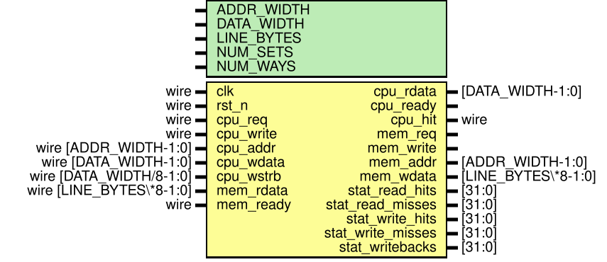

# Entity: l1_cache_controller 
- **File**: l1_cache_controller.v
- **Brief:**  Parameterized 2-Way Set-Associative L1 Cache Controller
- **Details:**  High-performance L1 cache controller with Write-Back and Write-Allocate policy, 1-bit True-LRU replacement, 1-cycle hit latency, and hardware telemetry counters.

## Diagram

## Description

## Generics

| Generic name | Type | Value | Description                                      |
| ------------ | ---- | ----- | ------------------------------------------------ |
| ADDR_WIDTH   |      | 32    | 32-bit byte addressable memory space             |
| DATA_WIDTH   |      | 32    | 32-bit CPU data bus width                        |
| LINE_BYTES   |      | 16    | 16 bytes per cache line (4 words = 128 bits)     |
| NUM_SETS     |      | 64    | Number of cache sets (64 sets)                   |
| NUM_WAYS     |      | 2     | Degrees of associativity (2-way set-associative) |

## Ports

| Port name         | Direction | Type                    | Description                                            |
| ----------------- | --------- | ----------------------- | ------------------------------------------------------ |
| clk               | input     | wire                    | Master clock input                                     |
| rst_n             | input     | wire                    | Active-low asynchronous reset                          |
| cpu_req           | input     | wire                    | High when CPU initiates read/write request             |
| cpu_write         | input     | wire                    | Access mode: 1 = Write, 0 = Read                       |
| cpu_addr          | input     | wire [ADDR_WIDTH-1:0]   | 32-bit byte address from CPU                           |
| cpu_wdata         | input     | wire [DATA_WIDTH-1:0]   | 32-bit write data from CPU                             |
| cpu_wstrb         | input     | wire [DATA_WIDTH/8-1:0] | 4-bit byte write strobes                               |
| cpu_rdata         | output    | [DATA_WIDTH-1:0]        | 32-bit read data returned to CPU                       |
| cpu_ready         | output    |                         | Acknowledges completion of request (stalls CPU when 0) |
| cpu_hit           | output    | wire                    | Status flag: asserted on 1-cycle cache hit             |
| mem_req           | output    |                         | Request to main memory                                 |
| mem_write         | output    |                         | Memory operation: 1 = Writeback line, 0 = Read line    |
| mem_addr          | output    | [ADDR_WIDTH-1:0]        | Line-aligned memory address                            |
| mem_wdata         | output    | [LINE_BYTES*8-1:0]      | 128-bit cache line write data to memory                |
| mem_rdata         | input     | wire [LINE_BYTES*8-1:0] | 128-bit cache line read data from memory               |
| mem_ready         | input     | wire                    | Acknowledgment from memory                             |
| stat_read_hits    | output    | [31:0]                  | Total number of successful read hits                   |
| stat_read_misses  | output    | [31:0]                  | Total number of read misses                            |
| stat_write_hits   | output    | [31:0]                  | Total number of successful write hits                  |
| stat_write_misses | output    | [31:0]                  | Total number of write misses                           |
| stat_writebacks   | output    | [31:0]                  | Total number of dirty line evictions written back      |

## Signals

| Name                                                                                    | Type                        | Description                                                       |
| --------------------------------------------------------------------------------------- | --------------------------- | ----------------------------------------------------------------- |
| state                                                                                   | reg [2:0]                   | Current FSM control state                                         |
| tag_mem_0   [0:NUM_SETS-1]                                                              | reg [TAG_BITS-1:0]          | Way 0 tag storage array (64 x 22 bits)                            |
| valid_mem_0 [0:NUM_SETS-1]                                                              | reg                         | Way 0 line valid flags (64 x 1 bit)                               |
| dirty_mem_0 [0:NUM_SETS-1]                                                              | reg                         | Way 0 line dirty flags (64 x 1 bit)                               |
| data_mem_0  [0:NUM_SETS-1]                                                              | reg [LINE_WIDTH-1:0]        | Way 0 line data storage array (64 x 128 bits)                     |
| tag_mem_1   [0:NUM_SETS-1]                                                              | reg [TAG_BITS-1:0]          | Way 1 tag storage array (64 x 22 bits)                            |
| valid_mem_1 [0:NUM_SETS-1]                                                              | reg                         | Way 1 line valid flags (64 x 1 bit)                               |
| dirty_mem_1 [0:NUM_SETS-1]                                                              | reg                         | Way 1 line dirty flags (64 x 1 bit)                               |
| data_mem_1  [0:NUM_SETS-1]                                                              | reg [LINE_WIDTH-1:0]        | Way 1 line data storage array (64 x 128 bits)                     |
| lru_mem     [0:NUM_SETS-1]                                                              | reg                         | True 1-bit LRU recency array per set                              |
| cur_tag         = cpu_addr[ADDR_WIDTH-1 : SET_INDEX_BITS + OFFSET_BITS]                 | wire [TAG_BITS-1:0]         | Extracted tag bits from current CPU address                       |
| cur_set         = cpu_addr[SET_INDEX_BITS + OFFSET_BITS - 1 : OFFSET_BITS]              | wire [SET_INDEX_BITS-1:0]   | Extracted set index from current CPU address                      |
| cur_word_offset = cpu_addr[OFFSET_BITS-1 : 2]                                           | wire [WORD_OFFSET_BITS-1:0] | Extracted word offset within cache line                           |
| latched_addr                                                                            | reg [ADDR_WIDTH-1:0]        | Latched CPU address during cache miss                             |
| latched_write                                                                           | reg                         | Latched CPU write enable during cache miss                        |
| latched_wdata                                                                           | reg [DATA_WIDTH-1:0]        | Latched CPU write data during cache miss                          |
| latched_wstrb                                                                           | reg [DATA_WIDTH/8-1:0]      | Latched byte write strobes during cache miss                      |
| latched_victim_way                                                                      | reg                         | Latched selected victim way (0 or 1)                              |
| saved_tag         = latched_addr[ADDR_WIDTH-1 : SET_INDEX_BITS + OFFSET_BITS]           | wire [TAG_BITS-1:0]         | Tag of latched miss address                                       |
| saved_set         = latched_addr[SET_INDEX_BITS + OFFSET_BITS - 1 : OFFSET_BITS]        | wire [SET_INDEX_BITS-1:0]   | Set index of latched miss address                                 |
| saved_word_offset = latched_addr[OFFSET_BITS-1 : 2]                                     | wire [WORD_OFFSET_BITS-1:0] | Word offset of latched miss address                               |
| way0_hit = valid_mem_0[cur_set] && (tag_mem_0[cur_set] == cur_tag)                      | wire                        | Asserted when Way 0 matches tag and is valid                      |
| way1_hit = valid_mem_1[cur_set] && (tag_mem_1[cur_set] == cur_tag)                      | wire                        | Asserted when Way 1 matches tag and is valid                      |
| is_hit   = way0_hit || way1_hit                                                         | wire                        | Asserted when either way hits                                     |
| hit_way  = way1_hit ? 1'b1 : 1'b0                                                       | wire                        | Way index that hit (0 or 1)                                       |
| victim_select = (!valid_mem_0[cu                                                        | wire                        | Selected victim way (0 or 1) for eviction                         |
| victim_is_dirty = (victim_select == 1'b0) ? dirty_mem_0[cur_set] : dirty_mem_1[cur_set] | wire                        | True if the victim line is dirty and requires writeback           |
| victim_is_valid = (victim_select == 1'b0) ? valid_mem_0[cur_set] : valid_mem_1[cur_set] | wire                        | True if the victim line is currently valid                        |
| i                                                                                       | integer                     | Loop index for array initialization                               |
| updated_line                                                                            | reg [LINE_WIDTH-1:0]        | Temporary buffer holding merged line data during write allocation |

## Constants

| Name              | Type | Value                                     | Description                                      |
| ----------------- | ---- | ----------------------------------------- | ------------------------------------------------ |
| OFFSET_BITS       |      | 4                                         | Log2(LINE_BYTES): 4 bits for 16-byte line offset |
| SET_INDEX_BITS    |      | 6                                         | Log2(NUM_SETS): 6 bits for 64 sets               |
| TAG_BITS          |      | ADDR_WIDTH - SET_INDEX_BITS - OFFSET_BITS | Tag bit width (32 - 6 - 4 = 22 bits)             |
| LINE_WIDTH        |      | LINE_BYTES * 8                            | Cache line width in bits (128 bits)              |
| WORDS_PER_LINE    |      | LINE_BYTES / (DATA_WIDTH / 8)             | Number of 32-bit words per line (4 words)        |
| WORD_OFFSET_BITS  |      | 2                                         | Word offset bit width within line (2 bits)       |
| STATE_IDLE        |      | 3'b000                                    | Idle and normal 1-cycle hit evaluation state     |
| STATE_COMPARE_TAG |      | 3'b001                                    | Tag comparison state                             |
| STATE_WRITE_BACK  |      | 3'b010                                    | Evict dirty victim line to lower memory          |
| STATE_ALLOCATE    |      | 3'b011                                    | Fetch requested line from lower memory           |

## Functions
- extract_word (input [LINE_WIDTH-1:0]       line_data; ) return ([DATA_WIDTH-1:0])
  -  Extracts a 32-bit word from a 128-bit cache line based on word index
- merge_write_line (input [LINE_WIDTH-1:0]       orig_line; ) return ([LINE_WIDTH-1:0])
  -  Merges a 32-bit CPU write word into a 128-bit line according to byte strobes
